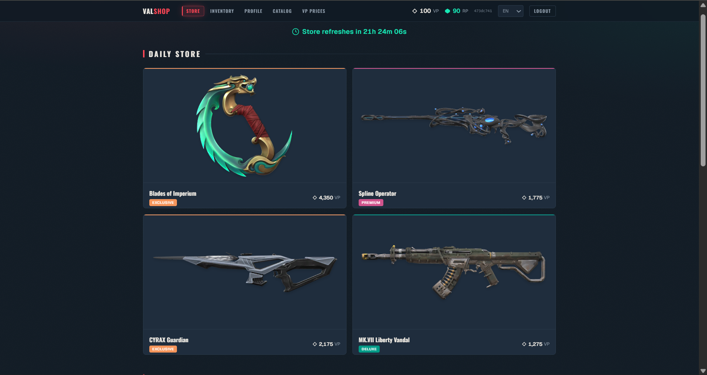

# Valorant Shop Checker

Check your Valorant store, skins, agents and match history from any device — without launching the game.


A web app for Valorant players. Sign in with your Riot account to see your daily store, your skin collection, your agent roster and your recent matches; no sign-in is needed to browse every skin in the game, the current featured bundle, or the VP price list. Built with a Python/FastAPI backend that handles Riot's OAuth authentication, and a React/TypeScript frontend with a Valorant-themed dark UI.



> **Disclaimer:** This application is not endorsed by Riot Games and does not reflect the views or opinions of Riot Games or anyone officially involved in producing or managing Riot Games properties. Riot Games and all associated properties are trademarks or registered trademarks of Riot Games, Inc.

> **Credit:** This project is a fork of [victorxia18/valorant-shop-checker](https://github.com/victorxia18/valorant-shop-checker), the original creator. All credit for the initial design and implementation goes to them.

## Features

### Signed in with Riot

| Page | What you get |
|---|---|
| **Store** | Your 4 daily skin offers with content-tier colours and VP prices, a countdown to the next rotation (with automatic refresh), and the featured bundles. Skins you already own get a "Purchased" overlay. Your VP and Radianite balance sits in the header. |
| **Inventory** | Every skin you own, with weapon and tier filters, search, and demo-video playback. |
| **Profile** | Riot ID and account level; VP, Radianite and **Kingdom Credits**; your **agent roster** (unlocked vs locked, filterable by role); and your **match history** — see below. |

**Match history**

- Last 20 matches, with a **Load more** button for older ones
- Filter by game mode (Competitive, Unrated, Swiftplay, Spike Rush, Deathmatch, Escalation, Replication, Team Deathmatch, Premier, Ability Draft Arena, …) — the chips are built from the modes you actually played
- Click a match for the **full scoreboard**: both teams, rank, ACS, K / D / A, +/-, K/D, DDΔ, ADR, HS%, first kills and first deaths (calculated from the round data)
- Win / loss / draw, round score, map, agent and match length at a glance

### No sign-in needed

| Page | What you get |
|---|---|
| **Catalog** | Every skin in the game, owned or not: filter by weapon (cheapest weapon first) and tier, search by skin name, and play the demo video |
| **Bundle** | The current featured bundle with item prices and a live countdown. Riot only serves the store to signed-in players, so the backend remembers the last bundle a signed-in player loaded and shows it here; it appears once anyone has opened the store after a rotation or restart. |
| **VP Prices** | VP pack prices in AUD and Radianite pack prices in VP, with calculators: AUD → VP, VP → AUD, VP → RP and RP → VP (best-value pack combinations) |

### Everywhere

- **Languages** — English, Traditional Chinese (繁中) and Simplified Chinese (简中). Skin, bundle, agent, map and weapon names follow the selected language; the choice is remembered.
- **Skin demo videos** — click a skin (Store, Inventory, Catalog, bundles) to watch its level videos in a modal.
- **Polished UI** — animated cards with cursor spotlight, a sliding nav highlight, and a skip link and reduced-motion support for accessibility.
- **Secure auth** — Riot OAuth implicit-grant flow; your password never touches this app.

## Login helper extension (optional)

Riot only allows login to finish at `http://localhost/redirect`, which normally means copying a URL by hand. The [`extension/`](extension) folder contains a small Chrome/Edge extension (Manifest V3) that removes that step: it catches the redirect and sends you straight back to the site, logged in, in the same tab.

- Download it from the login page ("Get the login helper extension") or at `<your-site>/login-helper.zip`; the zip is built from `extension/` on every deploy
- Install: `chrome://extensions` → **Developer mode** → **Load unpacked** → pick the unzipped folder
- It only asks for the `webNavigation` permission and a content script on the site itself
- If the site lives at a different address, edit `SITE_URL` in `extension/background.js` and the `matches` entry in `extension/manifest.json`

Without the extension, the original paste-the-URL flow still works.

## Tech Stack

| Layer | Technology |
|---|---|
| **Frontend** | React 19, TypeScript, Vite, Tailwind CSS 4, React Router |
| **Backend** | Python 3.12, FastAPI, httpx, uvicorn, Pydantic |
| **Auth** | Riot Games OAuth 2.0 implicit grant (`client_id=riot-client`) |
| **Asset Data** | [valorant-api.com](https://valorant-api.com) — skins, weapons, agents, maps, bundles, content tiers, localized names |
| **Deployment** | GitHub Pages (frontend), Render + Docker (backend), GitHub Actions CI/CD |

## Architecture

```
┌──────────────┐         ┌──────────────────┐        ┌──────────────────┐
│   Browser    │  HTTPS  │  FastAPI Backend │  HTTPS │  Riot APIs       │
│  (React SPA) │◄───────►│  (Render/Docker) │◄──────►│  auth, store,    │
│              │  JSON   │                  │        │  match history   │
└──────┬───────┘         └──────────────────┘        └──────────────────┘
       │                         │
       │  OAuth login            │  Startup
       ▼                         ▼
┌──────────────┐         ┌──────────────────┐
│  Riot Login  │         │ valorant-api.com │
│  (browser)   │         │ (asset cache)    │
└──────────────┘         └──────────────────┘
```

**Auth flow:** The user clicks "Sign In with Riot," which opens Riot's official login page. After authenticating, Riot redirects to `http://localhost/redirect#access_token=...` — since the app is deployed remotely, this shows a "can't connect" page, which is expected. The user copies the full URL from the address bar and pastes it into the app (or lets the [login helper extension](#login-helper-extension-optional) do it). The backend extracts the access token from the URL fragment and uses it to fetch entitlements, player info, and region data from Riot's APIs. A server-side session token is returned to the frontend and stored in `localStorage` for subsequent API calls.

**Profile data:** The Profile page makes several independent requests (name, level, wallet, agents, match history) in parallel, so one failing section shows "couldn't be loaded" instead of breaking the whole page. Match scoreboards are built from each match's round results; player names missing from the match data are filled in from Riot's name service.

## Design Decisions & Tradeoffs

| Decision | Why |
|---|---|
| **Paste-URL auth flow** | Riot's OAuth with `client_id=riot-client` enforces `redirect_uri=http://localhost/redirect` — no custom redirect URIs are allowed. Server-side credential auth was attempted but Riot blocks it with Cloudflare/captcha challenges. The paste-URL flow is the only reliable approach for a deployed web app; the extension automates it for people who install it. |
| **localStorage + Bearer tokens** (not cookies) | Cross-origin cookies are blocked by mobile Safari and other browsers with strict third-party cookie policies. `localStorage` with `Authorization: Bearer` headers works reliably across all platforms. |
| **sessionStorage for login stage** | Mobile browsers kill the JS context when the user switches tabs to complete Riot login. `sessionStorage` persists the UI state so the paste form survives tab switches. |
| **In-memory session store** | Simplicity over durability — sessions are short-lived (3h access token TTL) and the app targets a small user base. No database dependency needed. |
| **Asset cache at startup** | All skin/bundle/tier/agent/map data is loaded from valorant-api.com into O(1) lookup dicts on startup, avoiding per-request API calls and keeping response times fast. |
| **Public bundle from a signed-in player's store** | Riot's store API requires a signed-in player, and valorant-api.com does not say which bundle is featured. The backend caches the last featured bundle (with each bundle's own expiry) in memory and a temp file, and serves it to everyone. |
| **Localized names fetched in the browser** | Names for the selected language come straight from valorant-api.com's `?language=` option, so the backend stays language-agnostic. |
| **Docker `--no-cache` in CI** | Docker's `COPY` layer caching caused stale deployments where code changes weren't reflected. `--no-cache` ensures every deploy uses fresh code. |

## Local Development

### Prerequisites

- Python 3.12+
- Node.js 18+

### Backend

```bash
cd backend
python -m venv .venv
source .venv/bin/activate    # Linux/macOS
# .venv\Scripts\activate     # Windows

pip install -e .
cp .env.example .env         # then fill in ENCRYPTION_KEY
uvicorn app.main:app --reload
```

The API runs at `http://localhost:8000`.

### Frontend

```bash
cd frontend
npm install
npm run dev
```

The dev server runs at `http://localhost:5173` and proxies `/api` requests to the backend.

## Deployment

Both pieces deploy free, straight from this GitHub repo.

| Component | Platform | Trigger |
|---|---|---|
| **Frontend** | GitHub Pages | Push to `master` when `frontend/` or `extension/` changes (via GitHub Actions) |
| **Backend** | Render (free web service, Docker) | Push to `master` (Render's own GitHub auto-deploy) |

### Frontend deployment

1. In the repo's Settings → Pages, set **Source** to "GitHub Actions".
2. In Settings → Secrets and variables → Actions → Variables, add a repository variable `VITE_API_URL` set to your Render backend URL (e.g. `https://valorant-shop-checker-backend.onrender.com`).
3. Push to `master` — `.github/workflows/deploy-frontend.yml` packages the extension into `login-helper.zip`, builds the app (with the correct `/repo-name/` base path for Pages) and deploys it.

### Backend deployment

1. On [Render](https://render.com), choose **New +** → **Blueprint**, and point it at this repo — it reads [`render.yaml`](render.yaml) and provisions a free Docker web service from `backend/Dockerfile`.
2. Set the `ALLOWED_ORIGINS` env var on the service to your GitHub Pages URL (e.g. `https://<username>.github.io`).
3. Every push to `master` redeploys automatically. Backend changes (new endpoints, new data) only take effect after Render finishes redeploying.

Notes:

- Render's free tier spins the service down after ~15 minutes of inactivity. The first request after that takes ~30s to wake it up. Since sessions are stored in-memory ([session_store.py](backend/app/session_store.py)), logged-in sessions are lost on that restart, and the public featured bundle stays empty until someone signs in and opens the store again.
- During Riot's scheduled maintenance, Riot rejects store requests; the app shows "Riot's servers are down for scheduled maintenance" instead of a generic error.

### Environment variables

See [`backend/README.md`](backend/README.md) and [`frontend/README.md`](frontend/README.md) for details.

## Project Structure

```
valorant-shop-checker/
├── backend/
│   ├── app/
│   │   ├── routers/       # API route handlers (auth, store, profile)
│   │   ├── services/      # Riot API integration, asset cache, storefront, profile/matches
│   │   ├── models/        # Pydantic and dataclass models
│   │   ├── config.py      # App settings (pydantic-settings)
│   │   ├── session_store.py  # In-memory session management
│   │   └── main.py        # FastAPI app entry point
│   ├── Dockerfile
│   └── pyproject.toml
├── frontend/
│   ├── src/
│   │   ├── pages/         # Login, Shop, Inventory, Profile, Catalog, Bundle, Prices
│   │   ├── components/    # Header, skin/bundle cards, filters, video modal, etc.
│   │   ├── api/           # API client with token management
│   │   ├── context/       # Auth state, language and localized names
│   │   ├── utils/         # Skin filters, VP/RP price calculators, card motion helpers
│   │   └── types/         # TypeScript interfaces
│   ├── vite.config.ts
│   └── package.json
├── extension/             # Optional Chrome/Edge login helper extension
├── .github/workflows/     # CI/CD for the frontend (Pages)
└── README.md
```
